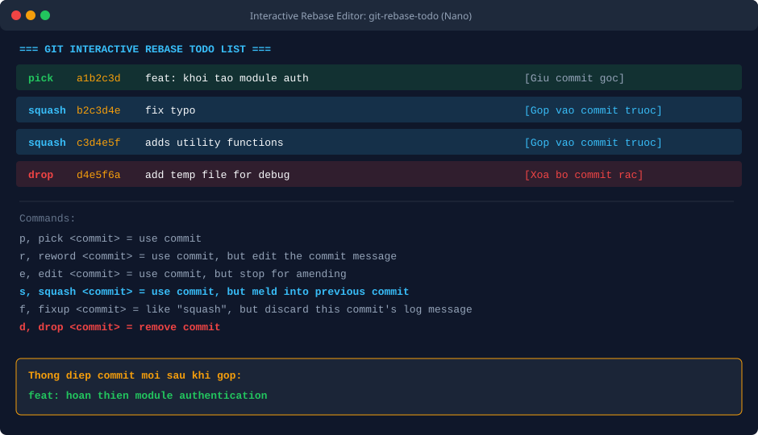
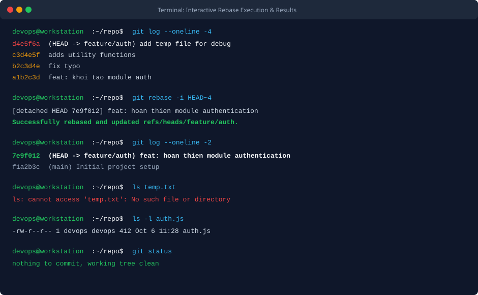

BÀI TẬP 2: TÁI CẤU TRÚC LỊCH SỬ COMMIT BẰNG INTERACTIVE REBASE

I. MỤC TIÊU BÀI TẬP

1. Nắm vững phương pháp sử dụng công cụ tương tác Interactive Rebase (git rebase -i) để biên tập và tái cấu trúc lịch sử commit cục bộ trước khi đẩy mã nguồn lên máy chủ trung tâm.
2. Thực hiện kỹ thuật gộp nhiều commit nhỏ lẻ (squash) thành một commit duy nhất có tính toàn vẹn và ý nghĩa logic cao.
3. Cập nhật thông điệp commit gộp thành tiêu đề chuẩn mực: feat: hoan thien module authentication.
4. Khai thác lệnh drop để xóa bỏ hoàn toàn một commit chứa tệp rác thử nghiệm (temp.txt), đảm bảo cây thư mục và lịch sử mã nguồn dự án luôn tinh gọn, sạch sẽ.
5. Kiểm tra và xác minh lịch sử commit sau khi hoàn tất qua lệnh git log --oneline.


II. BỐI CẢNH VÀ THÔNG SỐ CẤU HÌNH

1. Tên kho lưu trữ: repo-rebase-demo
2. Nhánh làm việc: feature/auth
3. Tệp tin tính năng hoàn thiện: auth.js
4. Tệp tin rác cần loại bỏ: temp.txt
5. Trạng thái 4 commit ban đầu:
- Commit 1: feat: khoi tao module auth (mã hash a1b2c3d)
- Commit 2: fix typo (mã hash b2c3d4e)
- Commit 3: adds utility functions (mã hash c3d4e5f)
- Commit 4: add temp file for debug (mã hash d4e5f6a)
6. Trạng thái sau khi Rebase thành công:
- Một commit duy nhất đại diện cho toàn bộ tính năng: 7e9f012
- Thông điệp commit hợp nhất: feat: hoan thien module authentication
- Tệp temp.txt bị xóa sổ hoàn toàn khỏi cây làm việc và lịch sử


III. CÁC BƯỚC THỰC HIỆN CHI TIẾT

1. Bước 1: Khởi tạo các commit thử nghiệm ban đầu

Tạo tệp mã nguồn auth.js và thực hiện commit thứ nhất:

```bash
echo "function auth() { return true; }" > auth.js
git add auth.js
git commit -m "feat: khoi tao module auth"
```

Chỉnh sửa tệp auth.js và tạo commit thứ hai:

```bash
echo "function auth(user, pass) { return true; }" > auth.js
git add auth.js
git commit -m "fix typo"
```

Bổ sung tính năng kiểm tra token và tạo commit thứ ba:

```bash
echo "function validateToken(token) { return token !== null; }" >> auth.js
git add auth.js
git commit -m "adds utility functions"
```

Tạo tệp tin rác tạm thời để debug và tạo commit thứ tư:

```bash
echo "DEBUG_LOG_TEMP_DATA" > temp.txt
git add temp.txt
git commit -m "add temp file for debug"
```

Kiểm tra lịch sử ban đầu bằng git log --oneline sẽ thấy xuất hiện 4 commit vụn vặt.

2. Bước 2: Kích hoạt công cụ Interactive Rebase

Thực hiện lệnh rebase tương tác lùi về 4 commit gần nhất:

```bash
git rebase -i HEAD~4
```

3. Bước 3: Cấu hình danh sách thao tác trong trình soạn thảo todo

Git sẽ tự động mở tệp cấu hình git-rebase-todo trong trình soạn thảo văn bản.
Cấu hình lại các lệnh cho từng commit như sau:

```text
pick a1b2c3d feat: khoi tao module auth
squash b2c3d4e fix typo
squash c3d4e5f adds utility functions
drop d4e5f6a add temp file for debug
```

Giải thích chi tiết các chỉ thị:
- pick a1b2c3d: Giữ lại commit đầu tiên làm commit cơ sở để các commit sau gộp vào.
- squash b2c3d4e: Gộp thay đổi của commit này vào commit phía trước nó.
- squash c3d4e5f: Tiếp tục gộp thay đổi của commit này vào commit phía trước.
- drop d4e5f6a: Xóa bỏ hoàn toàn commit này cùng toàn bộ các thay đổi mà nó tạo ra (tệp temp.txt).

Lưu và đóng trình soạn thảo lại.

4. Bước 4: Soạn thảo thông điệp commit hợp nhất

Sau khi xử lý các lệnh squash, Git sẽ tiếp tục mở màn hình soạn thảo thông điệp commit mới.
Xóa bỏ các dòng thông điệp cũ và thay thế bằng duy nhất một dòng thông điệp chuẩn mực:

```text
feat: hoan thien module authentication
```

Lưu và đóng trình soạn thảo để Git hoàn tất quá trình rebase.


IV. KIỂM TRA VÀ XÁC MINH LỊCH SỬ MÃ NGUỒN

1. Lệnh 1: Kiểm tra lịch sử commit rút gọn

```bash
git log --oneline -2
```

Đầu ra thực tế ghi nhận lịch sử đã được thu gọn hoàn hảo:

```text
7e9f012 (HEAD -> feature/auth) feat: hoan thien module authentication
f1a2b3c Initial project setup
```

Toàn bộ các commit nhỏ lẻ và commit rác đã được làm sạch, chỉ còn lại duy nhất một commit hoàn chỉnh.

2. Lệnh 2: Xác nhận tệp tin rác temp.txt đã bị xóa bỏ

```bash
ls temp.txt
```

Đầu ra xác nhận tệp rác không còn tồn tại:

```text
ls: cannot access 'temp.txt': No such file or directory
```

3. Lệnh 3: Xác nhận tệp auth.js tích lũy đầy đủ nội dung

```bash
cat auth.js
```

Nội dung tệp auth.js vẫn chứa đầy đủ các dòng mã nguồn phát triển qua cả 3 commit trước đó.

4. Lệnh 4: Kiểm tra trạng thái cây làm việc

```bash
git status
```

Đầu ra ghi nhận trạng thái sạch sẽ:

```text
On branch feature/auth
nothing to commit, working tree clean
```


V. HÌNH ẢNH MINH HỌA VÀ NHẬT KÝ THAO TÁC

1. Giao diện soạn thảo cấu hình Interactive Rebase todo



2. Terminal trước và sau khi thực hiện rebase thành công



3. Nhật ký phiên làm việc kiểm tra từ Terminal

```text
devops@workstation:~/repo$ git log --oneline -4
d4e5f6a (HEAD -> feature/auth) add temp file for debug
c3d4e5f adds utility functions
b2c3d4e fix typo
a1b2c3d feat: khoi tao module auth

devops@workstation:~/repo$ git rebase -i HEAD~4
[detached HEAD 7e9f012] feat: hoan thien module authentication
Successfully rebased and updated refs/heads/feature/auth.

devops@workstation:~/repo$ git log --oneline -2
7e9f012 (HEAD -> feature/auth) feat: hoan thien module authentication
f1a2b3c Initial project setup

devops@workstation:~/repo$ ls temp.txt
ls: cannot access 'temp.txt': No such file or directory
devops@workstation:~/repo$ git status
On branch feature/auth
nothing to commit, working tree clean
```


VI. HƯỚNG DẪN NỘP BÀI GITHUB

1. Đường dẫn trên GitHub: homework/session_05/ex2/ (hoặc Session05/BT2/)
2. Cơ chế nộp: Tệp tin mã nguồn auth.js và tệp báo cáo README.md chụp lại màn hình giao diện Interactive Rebase (cấu hình pick, squash, drop) cùng kết quả kiểm tra lịch sử commit sạch sẽ sau khi hoàn tất.


VII. KẾT LUẬN VÀ BÀI HỌC KINH NGHIỆM

1. Interactive Rebase là vũ khí tối thượng của kỹ sư phần mềm chuyên nghiệp giúp dọn dẹp lịch sử commit cục bộ trước khi mở Pull Request để đồng nghiệp duyệt code (Code Review).
2. Quy tắc gộp squash giúp gom các commit sửa lỗi nhỏ hoặc thử nghiệm thành một đơn vị tính năng hoàn chỉnh, giúp cây lịch sử dự án dễ đọc, dễ bảo trì và dễ tra cứu lỗi về sau.
3. Nguyên tắc an toàn cốt lõi: Chỉ thực hiện Interactive Rebase trên các nhánh tính năng cá nhân ở máy cục bộ. Tuyệt đối không rebase các commit đã được đẩy lên các nhánh chung (như main hoặc staging) đã chia sẻ với các thành viên khác trong nhóm phát triển.
